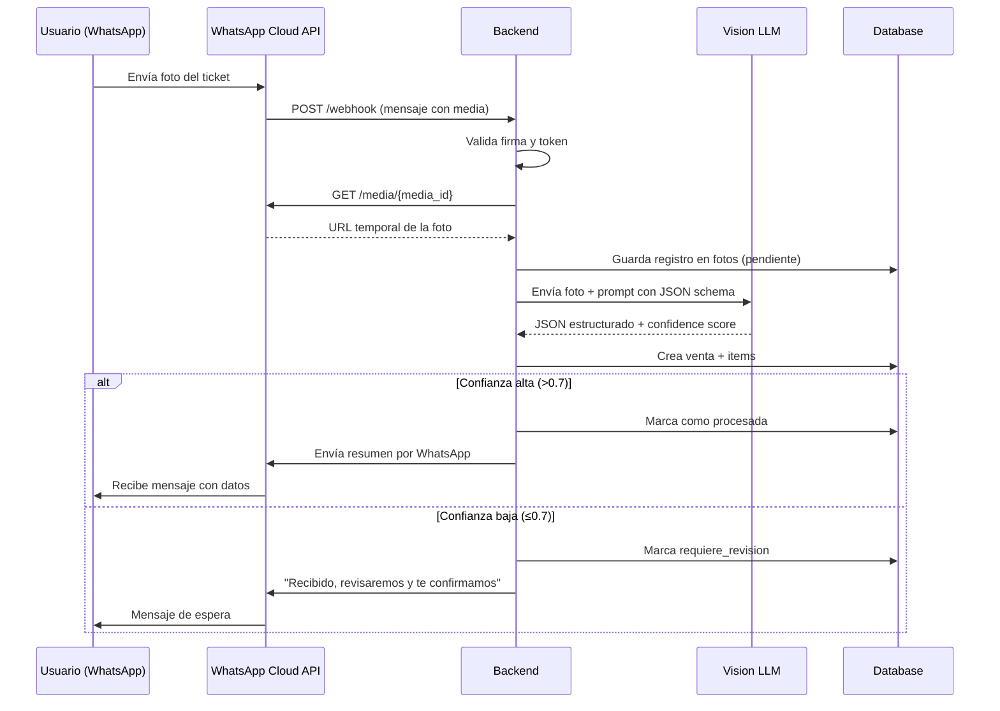
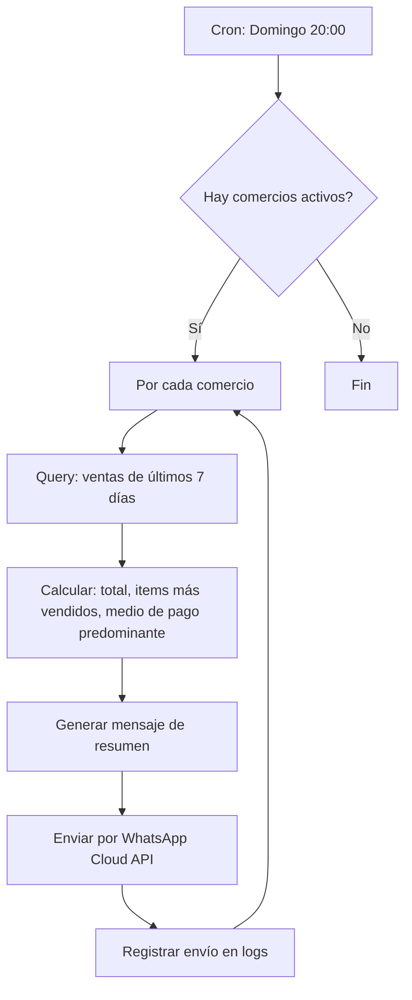
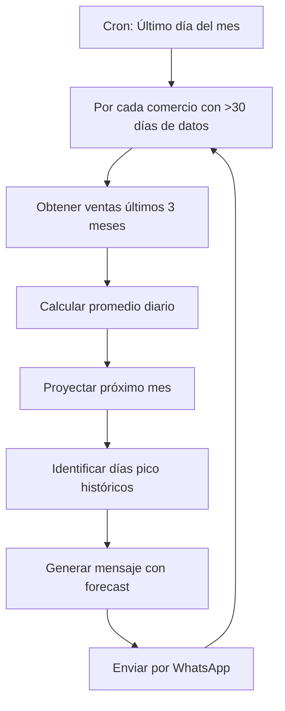
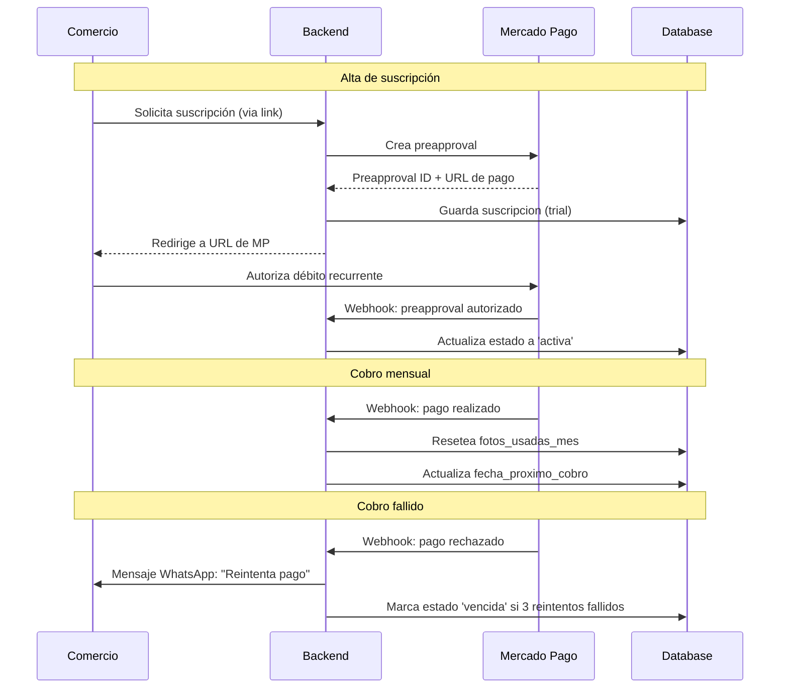

# Arquitectura Técnica: Ticket a Ventas

## Stack Tecnológico Recomendado

### Backend
- **Runtime**: Node.js 20+ LTS
- **Lenguaje**: TypeScript (strict mode)
- **Framework HTTP**: Express o Fastify
- **Validación**: Zod (schemas + runtime validation)

### Base de Datos
- **Motor**: PostgreSQL 15+
- **Hosting**: Neon (serverless Postgres con free tier generoso: 512 MB storage, 0.5 GB RAM)
- **Cliente**: `@neondatabase/serverless` (optimizado para edge) o `pg` (driver estándar)
- **Migraciones**: SQL puro en carpeta `migrations/` (sin vendor lock-in)
  - Ejemplo: `001_create_comercios.sql`, `002_create_ventas.sql`
  - Ejecutar con script custom o herramienta como `node-pg-migrate`

### APIs Externas

#### WhatsApp Cloud API
- Webhook para recibir mensajes con fotos
- API para enviar respuestas
- Verificación de webhook con token

#### Vision LLM (OCR/Extracción)
- **Opción A**: OpenAI GPT-4V (o GPT-4 Turbo con vision)
- **Opción B**: Anthropic Claude 3.5 Sonnet
- Prompt con JSON schema para respuesta estructurada
- Retornar score de confianza por extracción

#### Mercado Pago
- Preapproval API (suscripciones recurrentes)
- Webhook para notificaciones de pago
- SDK oficial de Mercado Pago para Node

### Otros Servicios
- **Storage de fotos**: Cloudflare R2 (compatible S3, 10 GB free/mes, sin egress fees)
  - Alternativa: guardar solo URLs temporales de WhatsApp (válidas 24-48hs)
- **Exports**: librería `exceljs` o `xlsx` para generar Excel
- **Cron jobs**: node-cron o servicio externo (Trigger.dev, Inngest)
- **Logs**: Winston o Pino
- **Deploy**: Railway, Render, Fly.io (Neon ya provee la DB)

---

## Modelo de Datos

### Tabla: `comercios`
```sql
CREATE TABLE comercios (
  id UUID PRIMARY KEY DEFAULT gen_random_uuid(),
  nombre VARCHAR(255) NOT NULL,
  telefono_whatsapp VARCHAR(20) UNIQUE NOT NULL,
  email VARCHAR(255),
  direccion TEXT,
  tipo_comercio VARCHAR(50), -- kiosco, almacen, verduleria, etc.
  creado_en TIMESTAMP DEFAULT NOW(),
  activo BOOLEAN DEFAULT true
);
```

### Tabla: `usuarios`
```sql
CREATE TABLE usuarios (
  id UUID PRIMARY KEY DEFAULT gen_random_uuid(),
  comercio_id UUID REFERENCES comercios(id) ON DELETE CASCADE,
  nombre VARCHAR(255),
  telefono VARCHAR(20),
  rol VARCHAR(50) DEFAULT 'dueño', -- dueño, empleado
  creado_en TIMESTAMP DEFAULT NOW()
);
```

### Tabla: `fotos`
```sql
CREATE TABLE fotos (
  id UUID PRIMARY KEY DEFAULT gen_random_uuid(),
  comercio_id UUID REFERENCES comercios(id) ON DELETE CASCADE,
  usuario_id UUID REFERENCES usuarios(id),
  whatsapp_media_id VARCHAR(255) NOT NULL,
  url_foto TEXT,
  fecha_subida TIMESTAMP DEFAULT NOW(),
  estado VARCHAR(50) DEFAULT 'pendiente', -- pendiente, procesada, error, revision
  metadata JSONB -- datos del mensaje de WhatsApp
);
```

### Tabla: `ventas`
```sql
CREATE TABLE ventas (
  id UUID PRIMARY KEY DEFAULT gen_random_uuid(),
  foto_id UUID REFERENCES fotos(id) ON DELETE SET NULL,
  comercio_id UUID REFERENCES comercios(id) ON DELETE CASCADE,
  fecha_venta DATE NOT NULL,
  hora_venta TIME,
  total DECIMAL(12, 2) NOT NULL,
  medio_pago VARCHAR(50), -- efectivo, debito, credito, transferencia
  confianza_score DECIMAL(3, 2), -- 0.00 a 1.00
  requiere_revision BOOLEAN DEFAULT false,
  revisada BOOLEAN DEFAULT false,
  datos_raw JSONB, -- respuesta completa del LLM
  creada_en TIMESTAMP DEFAULT NOW()
);
```

### Tabla: `items`
```sql
CREATE TABLE items (
  id UUID PRIMARY KEY DEFAULT gen_random_uuid(),
  venta_id UUID REFERENCES ventas(id) ON DELETE CASCADE,
  descripcion VARCHAR(500) NOT NULL,
  cantidad DECIMAL(10, 3) DEFAULT 1.0,
  precio_unitario DECIMAL(10, 2),
  subtotal DECIMAL(12, 2) NOT NULL,
  orden INT DEFAULT 0 -- orden en el ticket
);
```

### Tabla: `suscripciones`
```sql
CREATE TABLE suscripciones (
  id UUID PRIMARY KEY DEFAULT gen_random_uuid(),
  comercio_id UUID REFERENCES comercios(id) ON DELETE CASCADE,
  plan VARCHAR(50) NOT NULL, -- basico, plus
  precio_mensual DECIMAL(10, 2) NOT NULL,
  estado VARCHAR(50) DEFAULT 'trial', -- trial, activa, vencida, cancelada
  mercadopago_preapproval_id VARCHAR(255),
  fecha_inicio DATE NOT NULL,
  fecha_fin_trial DATE,
  fecha_proximo_cobro DATE,
  fotos_usadas_mes INT DEFAULT 0,
  limite_fotos_mes INT,
  creada_en TIMESTAMP DEFAULT NOW(),
  actualizada_en TIMESTAMP DEFAULT NOW()
);
```

### Índices Recomendados
```sql
CREATE INDEX idx_ventas_comercio_fecha ON ventas(comercio_id, fecha_venta DESC);
CREATE INDEX idx_fotos_comercio_estado ON fotos(comercio_id, estado);
CREATE INDEX idx_items_venta ON items(venta_id);
CREATE INDEX idx_suscripciones_comercio ON suscripciones(comercio_id);
```

---

## Flujos Principales

### 1. Recepción y Procesamiento de Foto



### 2. Generación de Resumen Semanal



### 3. Forecast Mensual



### 4. Billing y Suscripciones



---

## Schema de Extracción (Vision LLM)

### Prompt Template

```
Sos un asistente que extrae datos estructurados de fotos de tickets de venta en Argentina.

La imagen puede ser:
- Un ticket impreso
- Un cuaderno manuscrito con ventas
- Una lista de productos y precios

Extraé la siguiente información y devolvela en formato JSON:

{
  "fecha": "YYYY-MM-DD", // si no está, usar fecha de hoy
  "hora": "HH:MM", // opcional
  "items": [
    {
      "descripcion": "nombre del producto",
      "cantidad": 1.0,
      "precio_unitario": 100.0,
      "subtotal": 100.0
    }
  ],
  "total": 500.0,
  "medio_pago": "efectivo" | "debito" | "credito" | "transferencia" | null,
  "confianza": 0.95 // tu nivel de confianza en la extracción (0.0 a 1.0)
}

Notas:
- Si no podés leer algo, poné confianza baja (< 0.5)
- Si los items no tienen precio unitario, calculalo desde el subtotal
- Si no hay total, sumá todos los subtotales
- Montos siempre en pesos argentinos (ARS)
```

### Zod Schema (Backend)

```typescript
import { z } from 'zod';

export const ItemVentaSchema = z.object({
  descripcion: z.string().min(1).max(500),
  cantidad: z.number().positive().default(1.0),
  precio_unitario: z.number().nonnegative().optional(),
  subtotal: z.number().nonnegative(),
});

export const VentaExtractedSchema = z.object({
  fecha: z.string().regex(/^\d{4}-\d{2}-\d{2}$/),
  hora: z.string().regex(/^\d{2}:\d{2}$/).optional(),
  items: z.array(ItemVentaSchema).min(1),
  total: z.number().nonnegative(),
  medio_pago: z.enum(['efectivo', 'debito', 'credito', 'transferencia']).nullable(),
  confianza: z.number().min(0).max(1),
});

export type VentaExtracted = z.infer<typeof VentaExtractedSchema>;
```

---

## Seguridad

### WhatsApp Webhook
- Verificar firma X-Hub-Signature-256
- Validar verify_token en la fase de setup

### API Keys
- Almacenar en variables de entorno
- Nunca commitear al repo
- Rotar periódicamente

### Rate Limiting
- Limitar requests por comercio (ej: 100 fotos/día)
- Rate limit global en endpoints públicos

### Datos Sensibles
- No almacenar fotos permanentemente (solo URLs temporales)
- Encriptar datos de comercio si hay info fiscal

---

## Escalabilidad

### Fase 1 (MVP): 1-50 comercios
- Backend monolítico
- Postgres en Neon free tier (hasta 10 proyectos, 512 MB c/u)
- Procesar fotos síncronamente
- Fotos: URLs temporales de WhatsApp (no persistir)

### Fase 2: 50-500 comercios
- Background jobs con Bull/BullMQ + Redis
- Colas para procesamiento de fotos
- Cacheo de resúmenes frecuentes

### Fase 3: 500+ comercios
- Microservicios (webhook, extraction, billing)
- CDN para assets estáticos
- Múltiples workers de procesamiento
- Postgres replicado para reads
